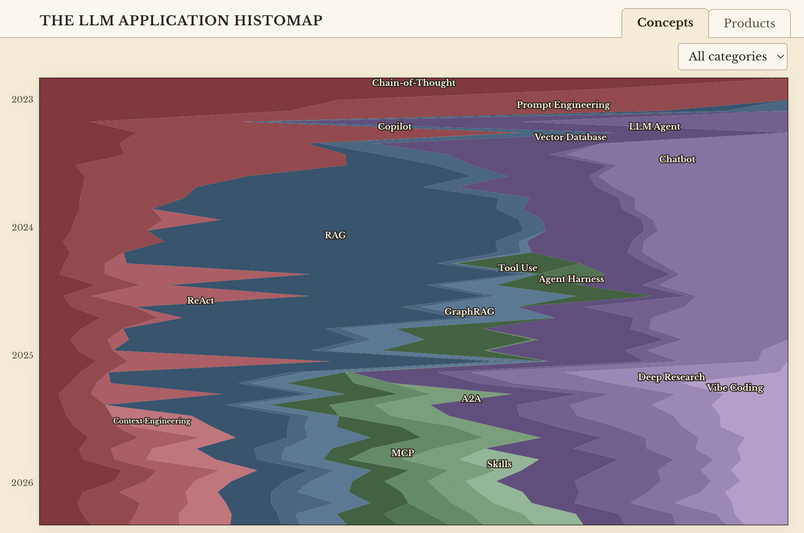
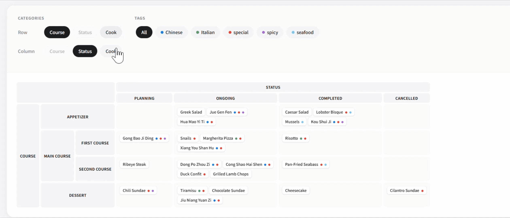
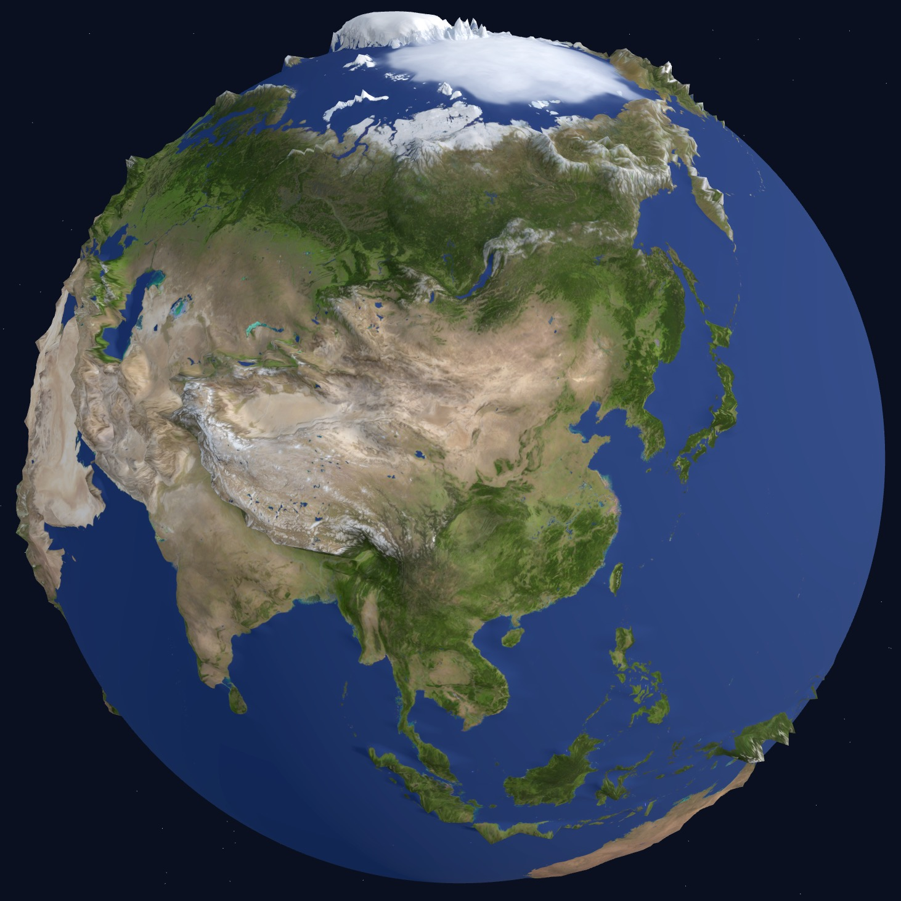



# Tools and Benchmarks

- [3Dio](https://github.com/XiangCHEN-dvi/3Dio) (Under Construction): Format conversion between different 3D formats.
- [Ramanujan Dataset](https://github.com/XiangCHEN-dvi/Ramanujan-Dataset) (Under Construction): A structured collection of Srinivasa Ramanujan's mathematical results.

# Analysis and Visualization

- [LLM Application Terminology Trend](https://xiangchen-dvi.github.io/llm-application-trend/): The emergence and decline of LLM application terms through time.

- [Interactive Multi-Category Table](https://github.com/XiangCHEN-dvi/interactive-multi-category-table): Interactive tables with alternative category views

- [2.5D Earth](https://xiangchen-dvi.github.io/beautiful-earth/): An interactable earth with terrain visualization.

# 工具与数据集

- [3Dio](https://github.com/XiangCHEN-dvi/3Dio)（建设中）：3D 数据格式间的相互转化工具。
- [Ramanujan Dataset](https://github.com/XiangCHEN-dvi/Ramanujan-Dataset)（建设中）：jsonl 格式的拉马努金的数学成果汇总。

# 分析与可视化

- [大模型应用层术语趋势](https://xiangchen-dvi.github.io/llm-application-trend/)：大模型应用层术语的兴起和衰落。

- [可交互多维表](https://github.com/XiangCHEN-dvi/interactive-multi-category-table)：可选层次化类别视角的可交互表格

- [2.5D 地球](https://xiangchen-dvi.github.io/beautiful-earth/)：可交互、有地形的地球可视化。

